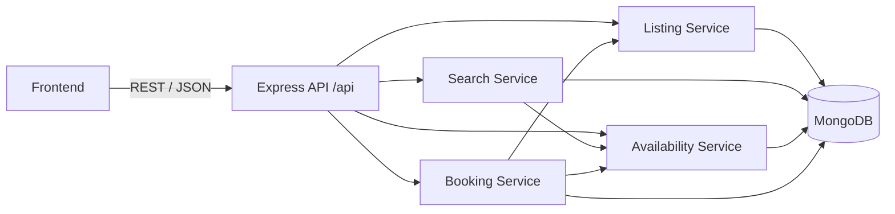

# airbnb-soa-cloud-project
Airbnb-inspired booking application using Service-Oriented Architecture (SOA) for Cloud Computing project.

## Project: Airbnb – Service-Oriented Architecture and Holiday Traffic Spikes

A simplified accommodation booking application used to demonstrate SOA, cost-conscious cloud deployment
and behaviour under normal and peak (holiday) traffic.

| Part | Owner | Status | Folder |
|---|---|---|---|
| Backend services, database, API, tests, backend report | Member 1 | Complete (local) | [`backend/`](backend/) |
| Frontend UI (search, listing details, booking forms) | Member 2 | Implemented; see frontend validation notes | [`frontend/`](frontend/) |
| AWS deployment, load testing, cost monitoring | Member 3 | Not started | – |

## Architecture



Details: [backend/docs/ARCHITECTURE.md](backend/docs/ARCHITECTURE.md)

## Quick start (backend)

Requires Node.js 20+ and MongoDB Community Server running locally.

```bash
cd backend
npm install
cp .env.example .env
npm run seed
npm run dev        # http://localhost:5000/health
npm test           # 111 tests
```

See [backend/README.md](backend/README.md) for full setup and the documentation index.

## Cost policy

Development and testing run entirely on local machines. No cloud resources are created as part of backend
development. See [backend/docs/DEPLOYMENT_GUIDE.md](backend/docs/DEPLOYMENT_GUIDE.md) for deployment notes and cost warnings.

## Frontend (Member 2)

The responsive frontend supports search, filters, listing details, availability checks, booking requests, reference lookup and cancellation. See [frontend/README.md](frontend/README.md) for setup, checks, limitations and static deployment instructions.

```powershell
cd frontend
npm.cmd ci
Copy-Item .env.example .env
npm.cmd run dev  # http://localhost:5173; start backend and MongoDB separately
```

Frontend work is based on `feature/member1-backend` and developed on `feature/member2-frontend`.
