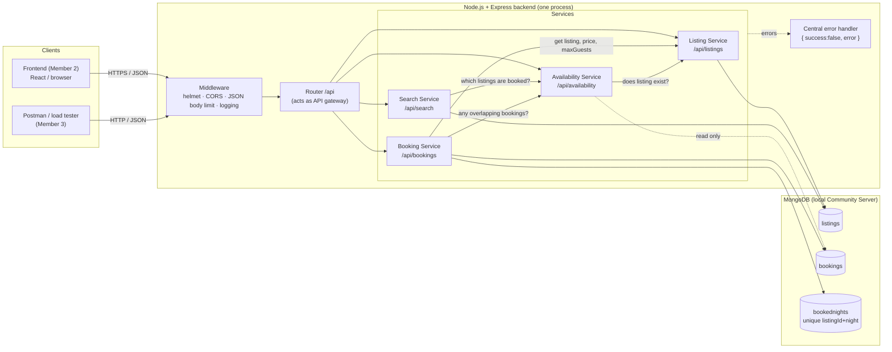
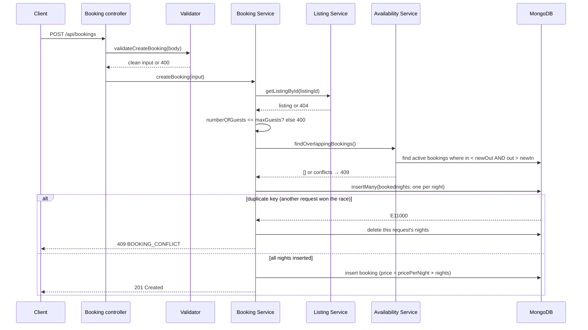

# Backend Architecture

## 1. Style: service-oriented modules in one deployable

The backend is split into four services with clear responsibilities and narrow interfaces:

| Service | Folder | Responsibility | Data it owns |
|---|---|---|---|
| **Listing Service** | `src/services/listing/` | Read and store accommodation listings | `listings` |
| **Search Service** | `src/services/search/` | Filter, sort and paginate listings | none (reads `listings`) |
| **Availability Service** | `src/services/availability/` | Decide whether dates are free; list booked ranges | none (reads `bookings`) |
| **Booking Service** | `src/services/booking/` | Create, read, confirm and cancel bookings | `bookings`, `bookednights` |

Rules followed in the code:

- A service never writes to another service's collection.
- When a service needs another service's data it calls that **service's functions**, not the collection.
  For example, the Booking Service gets the listing price from `listingService.getListingById()`.
- HTTP concerns (parsing requests, status codes) live in controllers and routes; services contain only business logic.
  This means a service can later be moved into its own process with an HTTP or message-queue interface
  without rewriting its logic.

All four services currently run in **one Node.js process** with **one MongoDB database**.
This is sometimes called a *modular monolith*. It was chosen deliberately:

- one process is cheap to host (fits on one small instance; see the deployment guide),
- the team has one backend to run, test and demonstrate,
- service boundaries are still explicit, so the system can be split into separately deployed services
  if one of them (for example Search during a holiday traffic spike) needs to scale independently.

## 2. SOA diagram



## 3. Request lifecycle

```
HTTP request
  → helmet (security headers) → cors (origin check) → express.json (10 KB limit) → morgan (logging)
  → router  (/api/listings | /api/search | /api/availability | /api/bookings)
  → controller   – reads req, calls validator, calls service, sends { success, data, meta }
  → validator    – checks input, throws ApiError(400) with field-level details
  → service      – business rules, talks to models / other services, throws ApiError(404/409)
  → model        – Mongoose schema → MongoDB
  ← errorHandler – any thrown error becomes { success:false, error:{ code, message, details } }
```

Express 5 forwards errors from `async` handlers to the error handler automatically,
so there are no `try/catch` blocks in controllers.

## 4. Booking flow and conflict prevention



### Why two checks?

1. **The overlap query** (`existing.checkIn < new.checkOut AND existing.checkOut > new.checkIn`)
   is easy to read and returns the conflicting dates for the error message.
   On its own it is **not** safe under concurrency: two requests can both run the query
   before either has saved its booking, and both would see "free".

2. **The `bookednights` collection** closes that gap. For a stay of 22–26 December the service inserts
   documents for the nights of the 22nd, 23rd, 24th and 25th. A **unique index on `{ listingId, night }`**
   means MongoDB itself rejects a second document for the same listing and night.
   Whichever request inserts first wins; the other gets a duplicate-key error (E11000),
   removes any nights it had inserted, and returns `409`.
   The check-out day is not a night, so back-to-back stays never collide.

This approach was chosen over multi-document transactions because **transactions need a MongoDB
replica set**, and the free local MongoDB server used for development is a standalone server.
The unique-index approach works on standalone servers, on replica sets and on MongoDB Atlas,
and it is tested with 15 simultaneous requests (exactly one succeeds, see `tests/booking.test.js`).

Status changes use the same idea: `findOneAndUpdate({ _id, bookingStatus: { $in: allowedFrom } })`
is a single atomic operation, so two clients cannot both cancel or confirm the same booking.

## 5. Folder structure

```
backend/
├── src/
│   ├── app.js                 Express app (middleware, routes, error handler) – no listen()
│   ├── server.js              Connects to DB, starts HTTP server, graceful shutdown
│   ├── config/
│   │   ├── env.js             Reads environment variables
│   │   └── db.js              MongoDB connection and index creation
│   ├── models/                Mongoose schemas: Listing, Booking, BookedNight
│   ├── services/
│   │   ├── listing/           Listing Service
│   │   ├── search/            Search Service
│   │   ├── availability/      Availability Service
│   │   └── booking/           Booking Service
│   ├── validators/            Input validation for each service
│   ├── controllers/           HTTP → service adapters
│   ├── routes/index.js        URL → controller mapping
│   ├── middleware/            notFound, errorHandler
│   └── utils/                 ApiError, dates, pagination, response helpers
├── scripts/                   seed.js, seedData.js
├── tests/                     Jest + Supertest suites
└── docs/                      This documentation
```

## 6. Cross-cutting concerns

| Concern | Implementation |
|---|---|
| Configuration | `.env` → `src/config/env.js`; nothing secret in code; `.env` is git-ignored |
| Security headers | `helmet`; `X-Powered-By` removed |
| CORS | allow-list from `CORS_ORIGIN`; requests without `Origin` (curl, Postman) allowed |
| Input limits | JSON body max 10 KB; `limit` capped at 50; stay max 30 nights |
| Injection safety | IDs validated as 24-hex strings; search text regex-escaped; `strictQuery` on; only whitelisted fields written |
| Errors | One error handler; generic 500 message; no stack traces in responses |
| Logging | `morgan` (`dev` format locally, Apache `combined` in production) |
| Health | `GET /health` returns 200 or 503 with DB state |
| Shutdown | SIGTERM/SIGINT close the HTTP server, then the DB connection |
