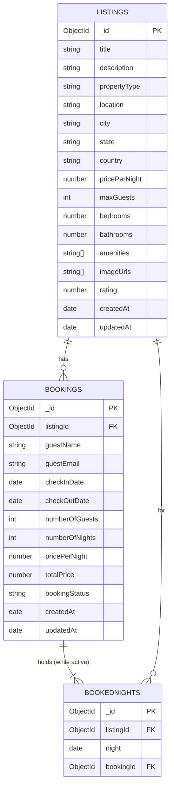

# Database Schema

Database: MongoDB (local Community Server for development).
Default database names: `airbnb_soa` (development) and `airbnb_soa_test` (automated tests, wiped by every test run).
Schemas are defined with Mongoose in `src/models/`. Every document gets a unique `_id` (ObjectId).



## `listings`

| Field | Type | Required | Validation |
|---|---|---|---|
| `title` | String | yes | trimmed, ≤ 120 chars |
| `description` | String | yes | ≤ 2000 chars |
| `propertyType` | String | yes | enum: Apartment, House, Villa, Cabin, Cottage, Studio, Loft, Guesthouse |
| `location` | String | yes | area/neighbourhood, ≤ 120 |
| `city` | String | yes | ≤ 80 |
| `state` | String | no | default `""` |
| `country` | String | yes | ≤ 80 |
| `pricePerNight` | Number | yes | ≥ 1 |
| `maxGuests` | Number | yes | whole number 1–20 |
| `bedrooms` | Number | yes | ≥ 0 (0 = studio) |
| `bathrooms` | Number | yes | ≥ 0 |
| `amenities` | [String] | no | default `[]` |
| `imageUrls` | [String] | no | default `[]` |
| `rating` | Number | no | 0–5, default 0 |
| `createdAt`, `updatedAt` | Date | auto | Mongoose `timestamps` |

**Indexes**

| Index | Purpose |
|---|---|
| `{ city: 1, pricePerNight: 1 }` | city + price-range searches |
| `{ propertyType: 1, pricePerNight: 1 }` | property-type searches |
| `{ maxGuests: 1 }` | guest-capacity filter |
| `{ createdAt: -1 }` | "newest first" listing pages |

## `bookings`

| Field | Type | Required | Notes |
|---|---|---|---|
| `listingId` | ObjectId → `listings` | yes | relationship to the listing |
| `guestName` | String | yes | 2–100 chars, trimmed |
| `guestEmail` | String | yes | valid email, stored lower-case |
| `checkInDate` | Date | yes | UTC midnight |
| `checkOutDate` | Date | yes | UTC midnight, must be after `checkInDate` (schema-level check too) |
| `numberOfGuests` | Number | yes | ≥ 1, ≤ listing `maxGuests` (checked in the service) |
| `numberOfNights` | Number | yes | calculated: (checkOut − checkIn) in days |
| `pricePerNight` | Number | yes | **snapshot** of the listing price at booking time |
| `totalPrice` | Number | yes | `pricePerNight × numberOfNights`, rounded to 2 decimals |
| `bookingStatus` | String | – | `Pending` (default), `Confirmed`, `Cancelled` |
| `createdAt`, `updatedAt` | Date | auto | |

The price is copied rather than looked up later so that a host changing the nightly price
does not change what an existing guest pays.

**Indexes**

| Index | Purpose |
|---|---|
| `{ listingId: 1, bookingStatus: 1, checkInDate: 1, checkOutDate: 1 }` | the availability overlap query |
| `{ guestEmail: 1, createdAt: -1 }` | future "my bookings" lookup |

## `bookednights`

One document per night held by an active booking. It exists to enforce "no double booking"
at database level (see `ARCHITECTURE.md` §4).

| Field | Type | Notes |
|---|---|---|
| `listingId` | ObjectId → `listings` | |
| `night` | Date | UTC midnight of the night (check-in day … day before check-out) |
| `bookingId` | ObjectId → `bookings` | which booking holds this night |

**Indexes**

| Index | Purpose |
|---|---|
| `{ listingId: 1, night: 1 }` **unique** | MongoDB rejects a second booking for the same listing and night |
| `{ bookingId: 1 }` | release all nights when a booking is cancelled |

Lifecycle: nights are inserted **before** the booking document; if the booking insert fails they are deleted.
Cancelling a booking deletes its nights, which frees the dates.

## Relationships

- `bookings.listingId` and `bookednights.listingId` reference `listings._id`.
- `bookednights.bookingId` references `bookings._id`.
- MongoDB does not enforce foreign keys; the Booking Service checks the listing exists before inserting.

## Initialisation and seed data

```bash
npm run seed
```

- Connects using `MONGODB_URI`, creates collections and all indexes (`Model.init()`).
- **Deletes all existing listings, bookings and booked nights** in that database, then inserts:
  - 20 listings in 16 cities across 10 countries, covering all 8 property types;
  - 5 bookings created **through the Booking Service** (so validation and night reservation run):
    3 Confirmed, 1 Pending, 1 Cancelled, with dates relative to today so they stay in the future.
- Refuses to run when `NODE_ENV=production` unless `--force` is passed.
- Prints sample listing and booking IDs for manual testing.

Data is always stored in MongoDB; there are no hard-coded arrays used as storage
(`scripts/seedData.js` is only the input to the seed script).
